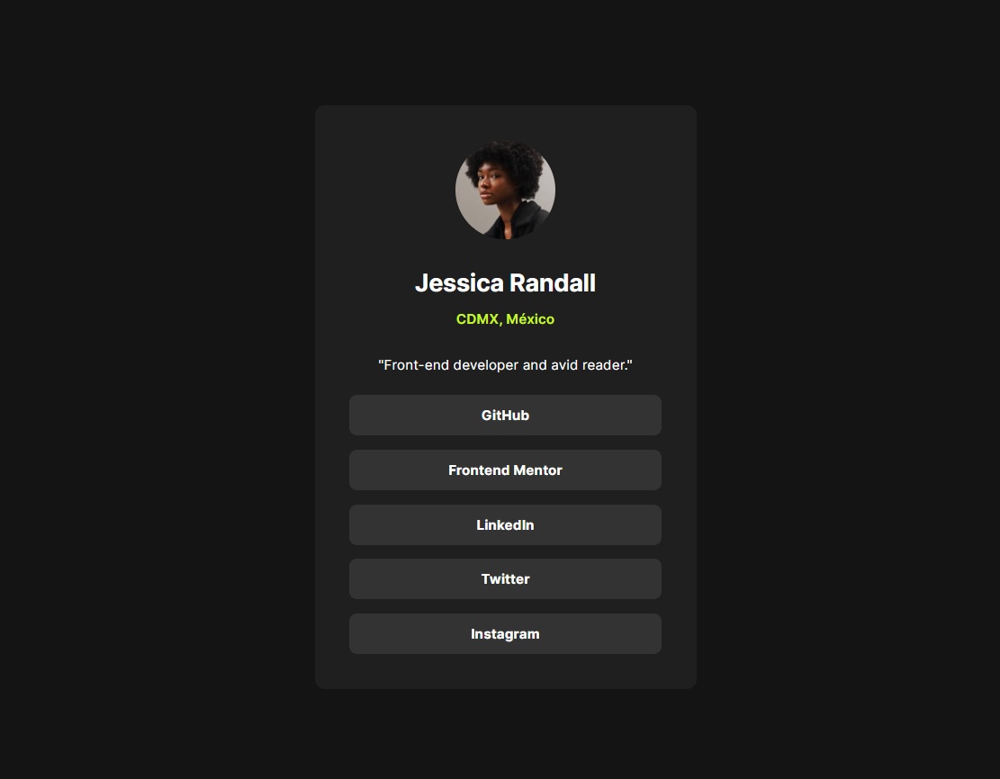
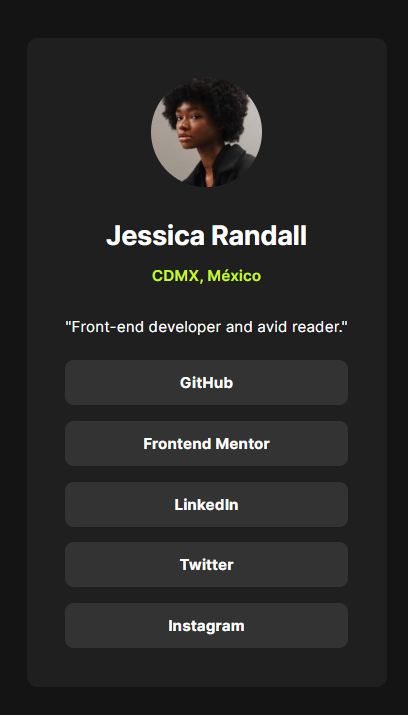

# Frontend Mentor - Solución del perfil de enlaces sociales

Esta es mi solución al reto [Social links profile de Frontend Mentor](https://www.frontendmentor.io/challenges/social-links-profile-UG32l9m6dQ). El objetivo fue construir una tarjeta de perfil adaptable y proporcionar estados de interacción claros para cada enlace social.

## Tabla de contenidos

- [Resumen](#resumen)
  - [El reto](#el-reto)
  - [Capturas](#capturas)
  - [Enlaces](#enlaces)
- [Mi proceso](#mi-proceso)
  - [Tecnologías utilizadas](#tecnologías-utilizadas)
  - [Lo que aprendí](#lo-que-aprendí)
  - [Desarrollo futuro](#desarrollo-futuro)
  - [Colaboración con IA](#colaboración-con-ia)
- [Autor](#autor)

## Resumen

### El reto

Los usuarios deben poder:

- Ver un perfil de enlaces sociales adaptable en pantallas móviles y de escritorio.
- Observar estados claros al pasar el puntero sobre los enlaces.
- Identificar el enlace que tiene el foco al navegar con el teclado.

### Capturas

#### Escritorio

#### Móvil

### Enlaces

- [Repositorio en GitHub](https://github.com/JesuSaid/Social-links-profile)

## Mi proceso

### Tecnologías utilizadas

- HTML5 semántico
- Modelo de caja de CSS
- Flexbox
- Anchos adaptables mediante `width` y `max-width`
- Archivos locales de la fuente Inter mediante `@font-face`
- Herencia de CSS y altura de línea sin unidad
- Estados de interacción `:hover` y `:focus-visible`

### Lo que aprendí

Este proyecto me ayudó a comprender cómo HTML proporciona la estructura del contenido mientras CSS controla su presentación. Practiqué la agrupación semántica del contenido principal del perfil y el uso de clases reutilizables para dar estilo a elementos relacionados.

También aprendí cómo Flexbox puede centrar una tarjeta en la ventana y organizar verticalmente los enlaces sociales. El uso de `box-sizing: border-box` facilitó mantener el espacio interior dentro del ancho previsto para la tarjeta, mientras que `width` y `max-width` permitieron adaptar el diseño a distintos tamaños de pantalla.

Para la tipografía, cargué localmente los pesos necesarios de Inter y aproveché la herencia para compartir el tamaño base y la altura de línea. Una altura de línea sin unidad mantiene el espaciado proporcional cuando cambia el tamaño de la fuente.

Finalmente, agregué estados para el puntero y el foco del teclado, de modo que los enlaces proporcionen una respuesta visual clara con distintos métodos de interacción.

### Desarrollo futuro

En proyectos futuros quiero continuar mejorando el HTML semántico, los textos alternativos accesibles, el espaciado adaptable y los nombres de las clases. También quiero adquirir más confianza al probar diseños en una variedad mayor de tamaños de pantalla y al utilizar las herramientas de desarrollo del navegador para inspeccionar los estilos calculados.

### Colaboración con IA

Utilicé Codex como mentor de aprendizaje durante el proyecto. Revisó mi HTML y CSS, explicó conceptos como el marcado semántico, la herencia, Flexbox, el modelo de caja y el foco del teclado, y me ayudó a identificar momentos adecuados para crear commits significativos en Git. Escribí y ajusté la implementación paso a paso a partir de esa orientación.

## Autor

- GitHub - [@JesuSaid](https://github.com/JesuSaid)
